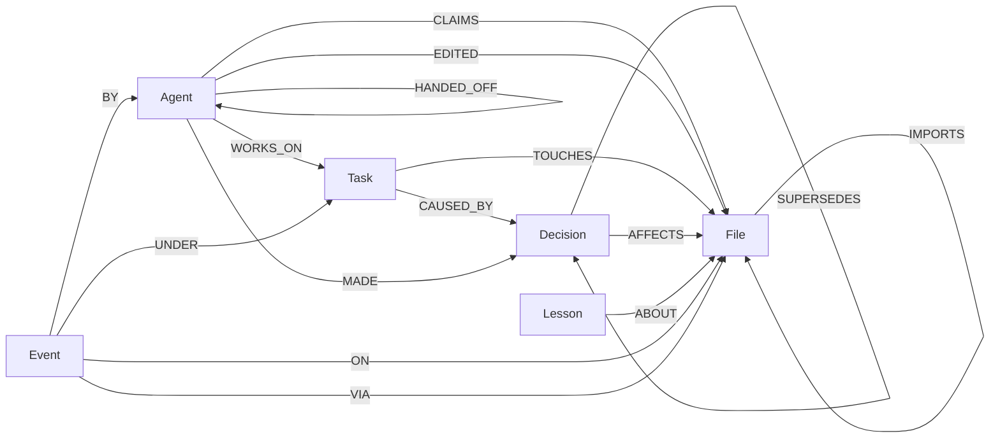
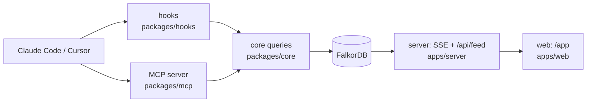

# Switchboard

Switchboard stops AI coding agents from breaking each other's code. It checks every edit against the repository's real import graph in FalkorDB. If the edit would collide with another agent's change, the edit is refused and the reply is the import path. A file lock only sees the filename.

**[Try the live demo](https://switchboard-agents.xyz/app?play=1)** (no install, nothing to sign in to) · **[Install](#install)** (two commands in Claude Code) · **[Design decisions and why](docs/DESIGN.md)**


[API health](https://switchboard-agents.xyz/api/health) · 2-min video (TBD) · Blog (TBD) · Tracks: **Agent Memory & Coordination** (main), **Agents That Act on Connected Data**

[](https://github.com/bhargava-gumpula/graph-hacks/actions/workflows/uptime.yml)

<!-- install:start -->

## Install

Switchboard needs Node 22 or newer and a FalkorDB it can reach. One command starts FalkorDB locally:

```bash
docker run -d -p 6379:6379 falkordb/falkordb
```

After that the agents never have to be told to use it. Hooks claim every edit, refuse one that collides with another agent's work, record it, and release the claims when the session ends. Each repo gets its own graph, `sb_<repo name>`, shared by all its worktrees.

**Claude Code (plugin: hooks, MCP server and a skill).** In Claude Code:

```
/plugin marketplace add bhargava-gumpula/graph-hacks
/plugin install switchboard@switchboard
```

**Cursor, or Claude Code without the plugin.** From a clone of this repo, point `init` at your repo:

```bash
git clone https://github.com/bhargava-gumpula/graph-hacks.git && cd graph-hacks && npm ci
npm run switchboard -- init ~/code/my-app
```

`init` writes the hooks and the MCP server for both editors into that repo (more under Quick start). In Cursor, enable `switchboard` in Settings → Tools & MCP.

**npm.** The package `switchboard-agents` (the CLI, the hooks and the MCP server) is built in `packages/npm` but is not on the npm registry yet. Until it is published, `npm i -g switchboard-agents` and `npx switchboard-agents` fail. To use the package now, pack it from a clone: `npm run build:plugin && (cd packages/npm && npm pack && npm i -g ./switchboard-agents-0.1.0.tgz)`, then run `switchboard init` in your repo.

[docs/INSTALL.md](docs/INSTALL.md) has every option, the settings and the limits.

<!-- install:end -->

<!-- quickstart:start -->

## Quick start

You need Node 22 or newer and Docker (Docker Desktop or OrbStack).

```bash
git clone https://github.com/bhargava-gumpula/graph-hacks.git && cd graph-hacks
npm run quickstart
```

That is all. It reuses a FalkorDB that already answers on port 6379, or starts one with `docker compose up -d`. Then it installs packages if `node_modules` is missing, creates `.env` from `.env.example`, parses `demo-repo`, builds the web app, starts the server and opens http://localhost:8787/app?tour=1. Run it again any time: finished steps are skipped. `npm run quickstart -- --dry-run` prints the plan and changes nothing; `--no-open` skips the browser.

**Use it on your own repo:**

```bash
npm run switchboard -- init ~/code/my-app
```

`init` merges the Switchboard hooks into the repo's git-ignored `.claude/settings.local.json` (so this machine's paths are never committed) and `.cursor/hooks.json`, and adds the MCP server to `.mcp.json` and `.cursor/mcp.json`. Other settings stay, and the first change keeps the original as `.bak`. `--npx` writes `npx -y switchboard-agents` commands instead, which can be committed and shared once the npm package is published. It parses the repo into its own graph (`sb_my_app`) with its own server port (8870 here, fixed by the name), and the hooks post only to that port. So the quickstart demo can keep running on 8787 and never sees this repo's claims. Then start that repo's server with `SERVER_PORT=8870 SB_GRAPH=sb_my_app npm run server` and open http://localhost:8870/app; `init` prints both lines. Until that server runs, the hooks fall back to the CLI on the same graph. Running it twice changes nothing. `--dry-run` prints the diff.

<!-- quickstart:end -->

## 30 seconds

Two agents share one repository.

1. Agent A claims `auth/session.ts` (task T1, "session ttl").
2. Agent B asks for `ui/LoginForm.tsx`. It is a different file, so a file lock says yes.
3. FalkorDB finds that `LoginForm.tsx` imports `api/login.ts`, which imports `session.ts`. B is refused:

> Agent B cannot edit ui/LoginForm.tsx. It reaches auth/session.ts, which agent A is already changing, through ui/LoginForm.tsx → api/login.ts → auth/session.ts. A file lock would have allowed the edit.

4. B asks for `ui/AboutPage.tsx`. The same query returns no rows. That empty result is the proof that nothing within 3 import hops is claimed, and the edit goes through.

That sentence is the reply of `POST /api/demo`. In Claude Code and Cursor the refusal arrives as a denied edit, with the path as the reason. Press Play at `/app?play=1`, or run `npm run scenario` to see the same story in a terminal.

## Why a graph

FalkorDB is the only store. There is no second database and no message broker. Remove it and the claim check, the event feed, the rounds, the why-trace and the briefing all stop.

| Feature | FalkorDB query | Without FalkorDB |
|---|---|---|
| Conflict: does this edit reach another agent's claim? | `(f)-[:IMPORTS*1..3]->(g)<-[c:CLAIMS]-(o)` and the reverse direction, hubs skipped. The path comes back. | Two recursive CTEs, one per direction, each with a hand-built path column and a hub filter. A lock table only matches names. |
| Blast radius: who breaks if this file changes? | `(d)-[:IMPORTS*1..3]->(f {path: $path})`, nearest hop per dependent, with the agents holding claims on each. | A reverse recursive walk, then a join to claims. |
| Rounds: which tasks can run together? | Task footprints, then `(f1)-[:IMPORTS*1..3]->(f2)` between every pair of tasks, in one read query. The pairs are coloured into rounds. | A recursive walk per pair of tasks, then the same colouring. |
| Hubs: which file is so widely imported that a path through it means nothing? | `CALL algo.pageRank('File', 'IMPORTS')` | Count importers by hand, or write PageRank. |
| Memory: was this tried before? | `CALL db.idx.fulltext.queryNodes('Decision', $q)` over the decision and its reason. | A separate search index kept in sync with the decisions table. |
| Hotspots: where do refusals keep happening? | `(e:Event)-[:VIA]->(f:File)` counted per file over a window. | Store each refusal's path as text and parse it back. |
| Why: why does this file look like this? | edit → agent → task → decision, plus `SUPERSEDES*1..5` to the newest decision. | Five joins, one of them recursive. |
| Brief: what should a new agent know first? | `(f)-[:IMPORTS*0..2]-(g)` around the files it will touch, then claims, decisions and lessons on that set. | The same walk, then one join per kind of memory. |

## Manual setup

The same steps as `npm run quickstart`, one at a time. You need Node 22 or newer and Docker running. The first FalkorDB pull is about 200 MB.

```bash
npm ci && npm run db:up && npm run parse -- demo-repo
```

`db:up` starts FalkorDB on port 6379 (the database) and 3000 (FalkorDB Browser). `parse` loads the demo repo: 35 files and 51 import edges.

Dev path, with hot reload:

```bash
npm run server    # API on http://localhost:8787
npm run web       # Vite on http://localhost:5173, proxies /api to the server
```

Open http://localhost:5173/app.

Single-port path, one process serving the built app:

```bash
npm run build -w @switchboard/web && npm run server
```

Open http://localhost:8787/app.

Only `npm run quickstart` reads `.env`, and a variable already set in your shell wins. Every other command reads only the environment; the defaults in the code match `.env.example`. To change a value for them, export it, for example `set -a; source .env; set +a`.

| Variable | Meaning |
|---|---|
| `FALKORDB_URL` | default `redis://localhost:6379` |
| `SB_GRAPH` | one FalkorDB graph per project, default `sb_demo` |
| `SERVER_PORT` | server port, default `8787` |
| `SB_PREFIX` | directory stripped from editor paths before a check. Default `demo-repo` |
| `SB_URL` | where the editor hooks reach the server. Default `http://localhost:8787` |
| `SB_AGENT` | agent id. Default `<editor>@<git branch>`, for example `claude@main` |
| `SWITCHBOARD_OFF` | `1` lets every edit through |
| `ANTHROPIC_API_KEY` | optional. If set, `brief_me` adds a short Haiku summary on top of the graph text. If unset, the graph text is the whole answer |

`npm test` runs the queries against the same FalkorDB, in temporary graphs named `sb_test_*`.

## Plug in your agent (3 min)

You need Node 22+, Docker, and Claude Code or Cursor. The hooks need nothing else (no `jq`).

```bash
npm install && npm run db:up && npm run parse -- demo-repo
npm run server        # keep it running
claude                # in the repo root
```

In Claude Code, approve the `switchboard` MCP server when it asks. The hooks load from `.claude/settings.json`.

In a second terminal, be agent A:

```bash
npm run switchboard -- claim auth/session.ts --agent A --task T1 --intent "session ttl"
```

Now ask the agent to edit `demo-repo/ui/LoginForm.tsx`. It is refused, and the reason is the path. Ask it to edit `ui/AboutPage.tsx`. That one is allowed. Then ask it to call `brief_me` and `why`.

- **Two real agents.** Run `SB_AGENT=alice claude` and `SB_AGENT=bob claude`, or give each agent its own git worktree. The agent id is `<editor>@<branch>`: Claude Code and Cursor on one branch are two agents (`claude@main`, `cursor@main`), but two Claude Code sessions on the same branch share one id and never conflict with each other.
- **Cursor.** Enable `switchboard` in Settings → Tools & MCP. `.cursor/hooks.json` loads automatically. Cursor drops the output of its session-start hook, so ask the agent to call `brief_me` first.
- **Off switch.** `SWITCHBOARD_OFF=1`. The hook log is `$TMPDIR/switchboard-hook.log`.

The MCP server exposes 15 tools:

| Tool | What it does |
|---|---|
| `register_agent` | Mark this agent active. |
| `claim` | Claim files before editing. `ok: false` carries the import path. |
| `release` | Drop your claims on some files, or all of them. |
| `heartbeat` | Tell the others you are still working; extends your claims. |
| `status` | Every agent and every live claim. |
| `record_decision` | Write a decision, its reason, and the files it affects. |
| `record_lesson` | Write a gotcha or a failed approach about some files. |
| `brief_me` | A briefing for a task or a directory: nearby claims, decisions, lessons, recent events, open tasks, the latest handoff. With `about`, also decisions and lessons anywhere that mention its words. |
| `why` | Trace a file to the edit, the agent, the task and the decision behind it. |
| `blast_radius` | Files that import this one, hop by hop, and who holds them. |
| `plan_task` | Open a task and list the files it will touch. |
| `parallel_batches` | Split open tasks into rounds: tasks in one round can run at the same time, round 0 first. |
| `handoff` | Give a task to another agent with a note. |
| `search_memory` | Find decisions and lessons by their words, the reason included. |
| `hotspots` | Files on the most refused import paths in the last N days. |

## Graph model

One FalkorDB graph per project (`SB_GRAPH`). Nothing is shared across graphs. The demo graph holds 35 `File` nodes and 51 `IMPORTS` edges.



Node labels: `File`, `Agent`, `Task`, `Decision`, `Lesson`, `Event`, and `Meta` (the `seq` counter).

| Edge | From → To | Meaning |
|---|---|---|
| `IMPORTS` | File → File | Parsed from the code. |
| `CLAIMS` | Agent → File | The agent is editing that file until `until`. |
| `EDITED` | Agent → File | The agent wrote the file. |
| `WORKS_ON` | Agent → Task | The agent is on this task. |
| `TOUCHES` | Task → File | A task's planned files. |
| `MADE` | Agent → Decision | Who made the decision. |
| `AFFECTS` | Decision → File | A decision applies to a file. |
| `CAUSED_BY` | Task → Decision | A task exists because of a decision. |
| `SUPERSEDES` | Decision → Decision | A newer decision replaced an older one. |
| `ABOUT` | Lesson → File | A lesson applies to a file. |
| `HANDED_OFF` | Agent → Agent | One agent gave a task to another. |
| `BY` / `ON` / `UNDER` | Event → Agent / File / Task | An event's agent, file and task. |
| `VIA` | Event → File | Every file on a refused claim's import path. |

Memory types map to the graph like this. Episodic: `Event` with `BY`, `ON` and `UNDER`. Semantic: `Decision` with `AFFECTS` and `SUPERSEDES`. Procedural: `Lesson` with `ABOUT`. Shared state and handoffs: `CLAIMS`, `WORKS_ON`, `HANDED_OFF`. Per-project tenancy: one graph each.

`Event.seq` is allocated in the same write that creates the event, so the log has no gaps. The server watches `seq`, and the page follows it.

## The Cypher

These are the queries the product depends on. They live in [`packages/core/src/queries/`](packages/core/src/queries/), and each has a test against a real FalkorDB. This section is generated: `npm run readme` imports the exported query strings and writes them here, so it cannot drift from the code.

<!-- cypher:start -->

### Conflict

`conflictQuery(3)` in [`packages/core/src/queries/conflict.ts`](packages/core/src/queries/conflict.ts). For each file an agent asks for, find another agent's live claim on the same file (SAME), on a file it imports within 3 hops (UPSTREAM), or on a file that imports it within 3 hops (DOWNSTREAM). The path comes back with the row. `SB_HOPS` sets the hop limit (1 to 5). A path may not run through a hub or use an `import type` edge; `SB_TYPE_IMPORTS=1` counts type-only imports again.

Why a lock table cannot do this: it compares names, so `LoginForm.tsx` and `session.ts` never meet. Here the import path is the answer.

```cypher
UNWIND $paths AS want
MATCH (f:File {path: want})<-[c:CLAIMS]-(o:Agent)
WHERE o.id <> $agent AND c.until > $now
RETURN want AS file, 'SAME' AS type, f.path AS claimed, [f.path] AS path, 0 AS hops,
       o.id AS agent, c.taskId AS taskId, c.intent AS intent, c.until AS until, coalesce(f.hub, false) AS hub
UNION ALL
UNWIND $paths AS want
MATCH p = (f:File {path: want})-[:IMPORTS*1..3]->(g:File), (g)<-[c:CLAIMS]-(o:Agent)
WHERE o.id <> $agent AND c.until > $now AND none(n IN nodes(p)[1..-1] WHERE coalesce(n.hub, false)) AND none(r IN relationships(p) WHERE coalesce(r.typeOnly, false))
RETURN want AS file, 'UPSTREAM' AS type, g.path AS claimed, [n IN nodes(p) | n.path] AS path, length(p) AS hops,
       o.id AS agent, c.taskId AS taskId, c.intent AS intent, c.until AS until, coalesce(f.hub, false) OR coalesce(g.hub, false) AS hub
UNION ALL
UNWIND $paths AS want
MATCH p = (g:File)-[:IMPORTS*1..3]->(f:File {path: want}), (g)<-[c:CLAIMS]-(o:Agent)
WHERE o.id <> $agent AND c.until > $now AND none(n IN nodes(p)[1..-1] WHERE coalesce(n.hub, false)) AND none(r IN relationships(p) WHERE coalesce(r.typeOnly, false))
RETURN want AS file, 'DOWNSTREAM' AS type, g.path AS claimed, [n IN nodes(p) | n.path] AS path, length(p) AS hops,
       o.id AS agent, c.taskId AS taskId, c.intent AS intent, c.until AS until, coalesce(f.hub, false) OR coalesce(g.hub, false) AS hub
```

### Conflict guard

`conflictGuard(3)` in [`packages/core/src/queries/conflict.ts`](packages/core/src/queries/conflict.ts). The same three checks as a prefix for a write. It yields one row when nothing conflicts and no rows otherwise, so whatever follows runs only when the claim is free.

Why a lock table cannot do this: its atomic step covers one name. This one covers every file within 3 import hops of the request.

```cypher
UNWIND $paths AS want
OPTIONAL MATCH (f:File {path: want})<-[c:CLAIMS]-(o:Agent)
WHERE o.id <> $agent AND c.until > $now
WITH want, count(c) AS same
OPTIONAL MATCH p = (f:File {path: want})-[:IMPORTS*1..3]->(g:File), (g)<-[c:CLAIMS]-(o:Agent)
WHERE o.id <> $agent AND c.until > $now AND none(n IN nodes(p)[1..-1] WHERE coalesce(n.hub, false)) AND none(r IN relationships(p) WHERE coalesce(r.typeOnly, false))
WITH want, same, count(c) AS up
OPTIONAL MATCH p = (g:File)-[:IMPORTS*1..3]->(f:File {path: want}), (g)<-[c:CLAIMS]-(o:Agent)
WHERE o.id <> $agent AND c.until > $now AND none(n IN nodes(p)[1..-1] WHERE coalesce(n.hub, false)) AND none(r IN relationships(p) WHERE coalesce(r.typeOnly, false))
WITH want, same, up, count(c) AS down
WITH sum(same + up + down) AS blocked
WITH blocked WHERE blocked = 0
```

### Claim: check and write in one query

`claimQuery(3)` in [`packages/core/src/queries/claims.ts`](packages/core/src/queries/claims.ts). The guard, then the write: the agent, its task, the `CLAIMS` edges and the `claim` event with the next `seq`. FalkorDB runs the write queries of one graph one at a time, so two racing claims cannot both pass the check.

Why a lock table cannot do this: it can make set-if-free atomic for a name, but it cannot put an import-path check in the same step.

```cypher
UNWIND $paths AS want
OPTIONAL MATCH (f:File {path: want})<-[c:CLAIMS]-(o:Agent)
WHERE o.id <> $agent AND c.until > $now
WITH want, count(c) AS same
OPTIONAL MATCH p = (f:File {path: want})-[:IMPORTS*1..3]->(g:File), (g)<-[c:CLAIMS]-(o:Agent)
WHERE o.id <> $agent AND c.until > $now AND none(n IN nodes(p)[1..-1] WHERE coalesce(n.hub, false)) AND none(r IN relationships(p) WHERE coalesce(r.typeOnly, false))
WITH want, same, count(c) AS up
OPTIONAL MATCH p = (g:File)-[:IMPORTS*1..3]->(f:File {path: want}), (g)<-[c:CLAIMS]-(o:Agent)
WHERE o.id <> $agent AND c.until > $now AND none(n IN nodes(p)[1..-1] WHERE coalesce(n.hub, false)) AND none(r IN relationships(p) WHERE coalesce(r.typeOnly, false))
WITH want, same, up, count(c) AS down
WITH sum(same + up + down) AS blocked
WITH blocked WHERE blocked = 0

MERGE (m:Meta {key:'seq'})
ON CREATE SET m.value = 0
SET m.value = m.value + 1
WITH m
CREATE (e:Event {seq: m.value, kind: $kind, at: $at, payload: $payload})
WITH e, m

MERGE (a:Agent {id: $agent})
ON CREATE SET a.status = 'active', a.startedAt = $at
SET a.lastSeen = $at, a.status = 'active'
CREATE (e)-[:BY]->(a)
FOREACH (_ IN CASE WHEN $taskId IS NULL THEN [] ELSE [1] END |
  MERGE (t:Task {id: $taskId})
  ON CREATE SET t.status = 'active', t.createdAt = $at
  MERGE (a)-[w:WORKS_ON]->(t)
  ON CREATE SET w.since = $at
  CREATE (e)-[:UNDER]->(t)
)
WITH e, m, a
UNWIND $paths AS path
MERGE (f:File {path: path})
ON CREATE SET f.hub = false, f.rank = 0.0
MERGE (a)-[c:CLAIMS]->(f)
SET c.since = $at, c.until = $until, c.ttl = $ttl, c.taskId = $taskId, c.intent = $intent
CREATE (e)-[:ON]->(f)
RETURN DISTINCT m.value AS seq
```

### Blast radius

`blastQuery(3)` in [`packages/core/src/queries/blast.ts`](packages/core/src/queries/blast.ts). Every file that imports the changed file within 3 hops (`SB_HOPS`), with its nearest hop count and the agents that hold a live claim on it. Zero rows means nothing depends on it. Type-only importers count here: a changed type breaks them at compile time.

Why a lock table cannot do this: it has no idea who depends on a file.

```cypher
MATCH p = (d:File)-[:IMPORTS*1..3]->(f:File {path: $path})
WHERE d <> f AND none(n IN nodes(p)[1..-1] WHERE coalesce(n.hub, false))
WITH d, min(length(p)) AS hops, $now AS now
RETURN d.path AS path, hops, [(a:Agent)-[c:CLAIMS]->(d) WHERE c.until > now | a.id] AS agents
ORDER BY hops, path
```

### Interference between tasks

`interfereQuery(3)` in [`packages/core/src/queries/schedule.ts`](packages/core/src/queries/schedule.ts). For every pair of unfinished tasks, find the closest connection between their files: the same file, or an import path within 3 hops either way, with the conflict check's hub and type-only rules. It is a read query: the scheduler colours its rows and stores nothing.

Why a lock table cannot do this: a lock exists only once an agent starts editing. This compares tasks before anyone has claimed anything.

```cypher
UNWIND $tasks AS a
UNWIND $tasks AS b
WITH a, b WHERE a.id < b.id
UNWIND a.paths AS p1
UNWIND b.paths AS p2
MATCH (f1:File {path: p1}), (f2:File {path: p2})
OPTIONAL MATCH up = (f1)-[:IMPORTS*1..3]->(f2)
WHERE none(n IN nodes(up)[1..-1] WHERE coalesce(n.hub, false)) AND none(r IN relationships(up) WHERE coalesce(r.typeOnly, false))
OPTIONAL MATCH down = (f2)-[:IMPORTS*1..3]->(f1)
WHERE none(n IN nodes(down)[1..-1] WHERE coalesce(n.hub, false)) AND none(r IN relationships(down) WHERE coalesce(r.typeOnly, false))
WITH a, b, f1, f2, min(length(up)) AS u, min(length(down)) AS d
WITH a, b, f1.path AS via,
     CASE WHEN f1 = f2 THEN 0 WHEN u IS NULL THEN d WHEN d IS NULL THEN u WHEN u < d THEN u ELSE d END AS hops
WHERE hops IS NOT NULL
WITH a, b, hops, via ORDER BY hops, via
WITH a.id AS a, b.id AS b, collect({hops: hops, via: via})[0] AS best
RETURN a, b, best.via AS via, best.hops AS hops
ORDER BY a, b
```

### Rounds: tasks that can run at once

`TASK_FOOTPRINTS` in [`packages/core/src/queries/schedule.ts`](packages/core/src/queries/schedule.ts). Every unfinished task's files, planned and claimed. `parallelBatches` passes them to the interference query above, then colours the interference graph: the task with the most interfering tasks goes first, and each task takes the lowest round none of them holds. Tasks in one round can run at the same time; round 0 runs first. On a chain where A touches B and B touches C, A and C share a round. One weakly connected component per batch, the old rule, ran all three in turn. Reading the rounds writes nothing to the graph.

Why a lock table cannot do this: it tells you who is waiting, not which tasks could never have collided.

```cypher
MATCH (t:Task)
WHERE coalesce(t.status, 'open') <> 'done'
WITH t,
     [(t)-[:TOUCHES]->(f:File) | f.path] +
     [(:Agent)-[c:CLAIMS]->(f:File) WHERE c.taskId = t.id AND c.until > $now | f.path] AS paths
WHERE size(paths) > 0
UNWIND paths AS path
WITH t, path ORDER BY path
RETURN t.id AS id, collect(DISTINCT path) AS paths
ORDER BY id
```

### Hubs (PageRank)

`MARK_HUBS` in [`packages/core/src/queries/hubs.ts`](packages/core/src/queries/hubs.ts). PageRank over `IMPORTS`, then a flag on heavily imported files (`lib/utils.ts` in the demo repo). A conflict path may not pass through a flagged file, so a shared helper that imports other code cannot chain all its callers into one conflict. In the demo repo `lib/utils.ts` imports nothing, so the rule changes no result there. We measured it against `algo.betweenness`; the numbers are under Limits.

Why a lock table cannot do this: it cannot tell a file everyone imports from a file two agents really share, so a path through it would look like a dependency.

```cypher
CALL algo.pageRank('File', 'IMPORTS') YIELD node, score
SET node.rank = score
WITH collect(node) AS files, avg(score) AS mean
UNWIND files AS f
OPTIONAL MATCH (d:File)-[:IMPORTS]->(f)
WITH f, mean, count(d) AS indegree
SET f.hub = indegree >= $minDegree OR (indegree >= $floor AND f.rank >= $factor * mean)
RETURN f.path AS path, f.rank AS rank, indegree, f.hub AS hub
ORDER BY rank DESC, path
```

### Memory search (full-text)

`SEARCH_DECISIONS` in [`packages/core/src/queries/search.ts`](packages/core/src/queries/search.ts). The full-text index on `Decision(text, why)`, so a word that only appears in the reason still finds the decision, with the files it affects. `SEARCH_LESSONS` does the same over `Lesson(text)`. The agent's words are cut to plain words joined by OR before they reach the index. `brief_me` with `about` and the `search_memory` tool use it. `search_memory` marks a replaced decision (superseded); `brief_me` leaves it out (`$activeOnly`).

Why a lock table cannot do this: it holds names and owners, no text to search.

```cypher
CALL db.idx.fulltext.queryNodes('Decision', $q) YIELD node, score
WITH node, score WHERE NOT ($activeOnly AND node.status = 'superseded')
OPTIONAL MATCH (node)-[:AFFECTS]->(f:File)
WITH node, score, collect(f.path) AS paths
RETURN 'decision' AS kind, node.id AS id, node.text AS text, node.why AS why, node.status AS status, paths, score
ORDER BY score DESC, id
LIMIT $limit
```

### Refusal hotspots

`HOTSPOTS` in [`packages/core/src/queries/history.ts`](packages/core/src/queries/history.ts). Every refusal is an `Event` linked by `VIA` to each file on its import path. This ranks the files that sat on the most refused paths since `$since`, including files in the middle of a path that nobody asked for.

Why a lock table cannot do this: it forgets a refusal as soon as it answers it.

```cypher
MATCH (e:Event)-[:VIA]->(f:File)
WHERE e.kind = 'conflict' AND e.at >= $since
RETURN f.path AS path, count(DISTINCT e) AS refusals, max(e.at) AS lastAt
ORDER BY refusals DESC, lastAt DESC, path
LIMIT $limit
```

### Why

`WHY_TRACE` in [`packages/core/src/queries/why.ts`](packages/core/src/queries/why.ts). From a file back through its edits to the agent, the task, the decision that caused the task, and the newest decision that replaced it.

Why a lock table cannot do this: it forgets the claim when it is released. This is the history.

```cypher
MATCH (f:File {path: $path})<-[:ON]-(e:Event {kind: 'edit'})
OPTIONAL MATCH (e)-[:BY]->(a:Agent)
OPTIONAL MATCH (e)-[:UNDER]->(t:Task)
OPTIONAL MATCH (t)-[:CAUSED_BY]->(d:Decision)
OPTIONAL MATCH (da:Agent)-[:MADE]->(d)
OPTIONAL MATCH (d)<-[:SUPERSEDES*1..5]-(newer:Decision {status: 'active'})
WITH f, a, t, d, da, collect(DISTINCT newer)[0] AS newer, max(e.seq) AS seq, count(DISTINCT e) AS edits
RETURN seq, edits, a.id AS agent, t.id AS task,
       d.id AS decisionId, d.text AS decision, d.why AS why, da.id AS decidedBy,
       newer.id AS latestId, newer.text AS latestText,
       [x IN [f, a, t, d] WHERE x IS NOT NULL | {label: labels(x)[0], id: coalesce(x.path, x.id)}] AS nodes
ORDER BY seq DESC, decisionId
LIMIT $limit
UNION ALL
MATCH (d:Decision {status: 'active'})-[:AFFECTS]->(f:File {path: $path})
OPTIONAL MATCH (da:Agent)-[:MADE]->(d)
OPTIONAL MATCH (t:Task)-[:CAUSED_BY]->(d)
WITH f, d, da, collect(t)[0] AS t
RETURN 0 AS seq, 0 AS edits, null AS agent, t.id AS task,
       d.id AS decisionId, d.text AS decision, d.why AS why, da.id AS decidedBy,
       null AS latestId, null AS latestText,
       [x IN [f, t, d] WHERE x IS NOT NULL | {label: labels(x)[0], id: coalesce(x.path, x.id)}] AS nodes
ORDER BY d.at DESC, decisionId
LIMIT $limit
```

### Briefing neighbourhood

`NEAR_FILES` in [`packages/core/src/queries/brief.ts`](packages/core/src/queries/brief.ts). The files within 2 imports of the area an agent is about to touch, in either direction. The briefing reads claims, decisions and lessons on exactly that set.

Why a lock table cannot do this: it can list who holds what, not what the neighbours of a file have learned.

```cypher
UNWIND $paths AS path
MATCH (f:File {path: path})
MATCH p = (f)-[:IMPORTS*0..2]-(g:File)
WHERE none(n IN nodes(p)[1..-1] WHERE coalesce(n.hub, false))
RETURN g.path AS path, min(length(p)) AS hops
```

<!-- cypher:end -->

### What the plan looks like

`GRAPH.PROFILE` on the conflict query, with agent A holding `auth/session.ts` and agent B asking for `ui/LoginForm.tsx`. This is the UPSTREAM branch of the `Union`, with the record counts left out; the SAME and DOWNSTREAM branches look alike. FalkorDB reported a median of 0.17 ms of internal execution time over 25 runs (0.12 to 0.46 ms, on a laptop shared with other jobs).

```text
Union
    Project
        Filter
            PathBuilder
                Filter
                    Conditional Variable Length Traverse | (f)-[_anon_0:IMPORTS*1..3]->(g)   0.024 ms
                        Filter
                            Filter
                                Edge By Index Scan | (o)-[c:CLAIMS]->(g:File)                0.004 ms
                                    Unwind
```

The plan starts at the live claims, through the index on `CLAIMS(until)`, and walks at most 3 `IMPORTS` hops from there. In this plan the cost scales with live claims, not repo size.

### Why not `shortestPath()`

FalkorDB allows `shortestPath()` only in `WITH` and `RETURN`, and it cannot carry the hub filter. So the query enumerates the paths (3 hops by default, `SB_HOPS` up to 5) and TypeScript keeps the shortest one per file and agent. The hop bound is written into the query text because Cypher cannot take a parameter as a variable-length bound. It is checked to be an integer from 1 to 5 first.

## Architecture



Before an edit, the hook asks the server (or the CLI when the server is down) and denies the edit if the check finds a path. After an edit, it records the edit. The server reads new events from FalkorDB and pushes them over SSE. If a proxy buffers SSE, the page falls back to polling `GET /api/feed`.

## Benchmark

```bash
npm run bench
```

Agent A holds `auth/session.ts` and changes what `sessionLabel` returns. Agent B edits `ui/LoginForm.tsx` and uses that value. Each edit passes the TypeScript compiler on its own. Merged, they do not. Every trial copies `demo-repo`, applies the edits, and runs the real `tsc`.

- **Without Switchboard** models two agents with a plain file lock and no check before merge. The lock lets B in, because B asks for a different file. Both agents finish, both edits land, and the merged build breaks. A CI run of `tsc` on the merge would catch this too, but only after both agents are done, and then B's change has to be reworked on top of A's.
- **With Switchboard** B's claim is refused while A holds `session.ts`, before B writes a line, and the refusal names the import path to A's file. A's edit lands and A releases. B then claims, applies its edit on top of A's, and its own `tsc` run catches the clash, so B's edit does not land.

So the 0 / 10 is not something only Switchboard could do: any check before merge also keeps the broken build out. What Switchboard changes is when the clash is found. B learns about it before it starts, with the path, instead of from a red build after both agents have finished.

<!-- bench:start -->

| | Broken builds | When the clash shows up | What happened |
|---|---|---|---|
| Without Switchboard (a file lock, no check before merge) | 10 / 10 | After both edits land, in a build of the merge | B's edit landed in 10 / 10 runs. |
| With Switchboard | 0 / 10 | Before B writes: its claim is refused with the import path | B's claim was refused 10 / 10 times. After A released, B's own `tsc` on top of A's edit caught the clash 10 / 10 times. B's edit landed in 0 / 10 runs. |

- Agent A holds `auth/session.ts`. Agent B edits `ui/LoginForm.tsx`. The refusal: UPSTREAM, 2 hops, ui/LoginForm.tsx → api/login.ts → auth/session.ts.
- The untouched repo, A's edit alone and B's edit alone all pass `tsc`. Merged, `tsc` fails: `ui/LoginForm.tsx(9,67): error TS2339: Property 'toUpperCase' does not exist on type '{ user: string; at: string; }'.`
- The conflict check (`findConflicts`, one FalkorDB query from Node) took a median of 0.69 ms (range 0.56 to 1.35 ms) over 10 runs. The machine was busy: 1-minute load average 4.84 on 10 cores.
- Last run: 2026-10-17, TypeScript 5.9.3, Node v26.9.0.

Pair census, one query over the parsed import graph (`npm run pairs`). A pair is two different files, counted once, by the conflict check's default rules: no path through a hub, no `import type` edge. A file lock collides only on the same path, so by definition it catches none of them:

| Repo | Files | Pairs | Caught by a file lock | 1 hop | Within 3 hops | 2 to 3 hops (missed by a one-hop check) |
|---|---|---|---|---|---|---|
| `demo-repo/` | 35 | 595 | 0 | 48 | 72 | 24 |
| `apps/web/` | 32 | 496 | 0 | 43 | 79 | 36 |

<!-- bench:end -->

What this does not show:

- The agents are scripted, not live model sessions. B waits and A releases through calls made in sequence, not real concurrency.
- It is one scenario on a 35-file synthetic repo. It shows the check catches that collision. It does not show how often real agents collide.
- The run is deterministic. N = 10 shows that it repeats, not a statistic.
- The build counts are the same every run by construction. The timing is the one noisy number: it comes from one local FalkorDB, and it moves with machine load.
- It does not model what a missed collision costs, or how long rework takes. It does not compare against a CI check, which would also keep the broken build out of `main`, only later.

The full description is in [`bench/REPORT.md`](bench/REPORT.md).

## FalkorDB lessons

Four things we hit, each with a fix in the code.

1. `shortestPath()` is allowed only in `WITH` and `RETURN`. FalkorDB rejects it inside `MATCH`.
2. A variable-length bound cannot be a parameter. `*1..$k` fails, so `k` is validated and written into the text.
3. In one projection, `same + count(c)` returned null, and a null guard let every claim through. Each count now has its own `WITH`, and the filter comes after the last one.
4. `algo.pageRank` errors on a graph with no `File` nodes. `markHubs` counts files first.

## Limits

- TypeScript only. The parser reads static imports, re-exports and `import("literal")`. It does not see `require()` or computed imports.
- File-level. Two agents editing different functions in the same file still conflict. Two files that share only a database table or a config value do not.
- 3 import hops by default. A collision four or more imports apart is not caught. `SB_HOPS` sets 1 to 5: fewer hops means fewer refusals and more missed collisions.
- `import type` edges do not count in the conflict check or the rounds, because a type-only import is erased at runtime and usually names a stable interface. A changed type can still break a type-only importer's build; `SB_TYPE_IMPORTS=1` counts them. The blast radius always counts them.
- Paths do not pass through hubs. Editing a hub such as `lib/utils.ts` conflicts with its importers, but two files that merely share a hub do not conflict.
- The hub rule is PageRank plus an in-degree floor, tuned on the 35-file demo repo. On this repo's `apps/web` (104 files, at commit `fc51788`) it flags 3 files and drops 13 of the 292 file pairs within 3 value-import hops (4.5%), or 99 of 400 (24.8%) when type-only imports count. We tried `algo.betweenness` with the same shape of rule: it flags 2 files and drops the same pairs there, but on the demo repo it also flags `api/notes.ts` and `api/users.ts` and drops 10 of 72 pairs, so we kept PageRank. A widely imported file that imports nothing, like `lib/utils.ts`, never sits inside a path, so only hubs that import other code change results. Precision and recall against real collisions are not measured.
- Rounds come from greedy colouring, which is not always the fewest rounds. On `apps/web`, 20 tasks of 2 random files each (3 seeds) put 17 to 20 tasks in one batch under the old one-component-per-batch rule; colouring needs 4 or 5 rounds. With 6 files per task, 146 to 170 of the 190 task pairs interfere, and it still needs 10 to 14 rounds instead of 20 in turn. The interference is recomputed on every read, with one path query over every pair of open tasks' files.
- Memory search matches words of 3 or more letters, with English stemming. It finds words, not meaning.
- The import graph is live per edit: after each edit an agent makes, that file's imports are updated in the graph. Saves people make are picked up by `switchboard watch` (or `SB_WATCH=1` with `SB_REPO` on the server). A change made any other way waits for the next parse. To share one graph across machines, see [docs/CLOUD.md](docs/CLOUD.md).
- A claim is advice unless the editor runs the hook. Claude Code and Cursor both hard-block a denied edit. An agent with no hook only follows the contract of calling `claim`.

## Competitors

We read the READMEs and docs of the tools we found on Oct 14 (the list is in [`docs/research/SWITCHBOARD-COMPETITORS.md`](docs/research/SWITCHBOARD-COMPETITORS.md)). None of them checks an agent's claim against a parsed import graph and keeps decisions, lessons and edit history in that same graph database. Nerveplane schedules from hand-declared scopes and keeps its ledger in SQLite. wit is advisory and has no decision memory. Claude Code agent teams share a task list and tell you to give each teammate different files. A filename lock cannot express "these two files look independent and are two imports apart."

## AI disclosure

**What AI wrote.** AI coding agents wrote almost all of the code, the Cypher, the tests and the docs, this README included: Cursor (Claude Opus 5.5 and Grok 4.7) and Claude Code (Claude Opus 5.5). A main Opus 5.5 chat wrote the task briefs, reviewed the branches and merged them. Commits carry a `Co-Authored-By` line that names the tool: 267 of the 286 commits on `main` on the evening of Oct 17 have one. The README's Cypher section is generated from the query files by `npm run readme`. The ideas were screened, and the build was reviewed, by panels of AI advisors; those notes and the per-task briefs are on the git branch `archive/process`, not in this tree.

**What the owner decided.** The owner picked the idea, the two tracks and the name. He required that FalkorDB be the only store and that a claim be checked against the dependency graph parsed from the code. He chose the coding setup and the models, the optional AI briefing summary, the with/without benchmark, the owner's-voice video, the domain, and the full UI rebuild on Oct 17. He ran the day-0 editor tests that needed a person (the Cursor chat steps), approved making the repo public, and bought the domain. These are recorded in [`docs/PLAN.md` §0.6](docs/PLAN.md#06-decisions-already-made-owner-oct-1314) and [`docs/DEVLOG.md`](docs/DEVLOG.md). [`docs/DESIGN.md`](docs/DESIGN.md) lists the design decisions, the reason for each, and which came from the owner and which from a review.

The first code commit (`aae6dc4`, Oct 14, 11:09 PM PT) came after the Oct 14 11:31 AM PT start. Every commit before it is Markdown notes, plus one Cursor rules file.

Inside the product, the only model call is an optional Claude Haiku summary of a briefing (`packages/core/src/summarize.ts`). It runs only when `ANTHROPIC_API_KEY` is set. The conflict check, the rounds and the why-trace never call a model.

## License

[MIT](LICENSE)
