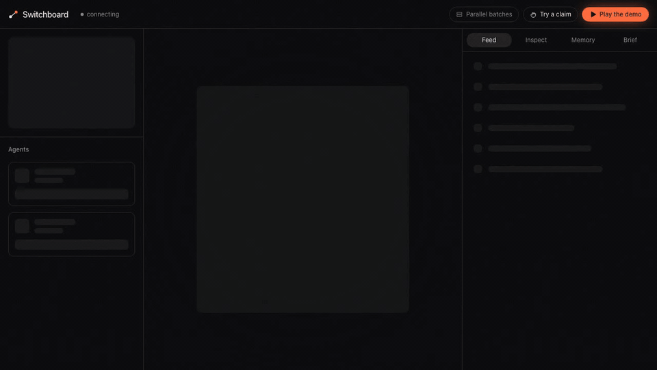
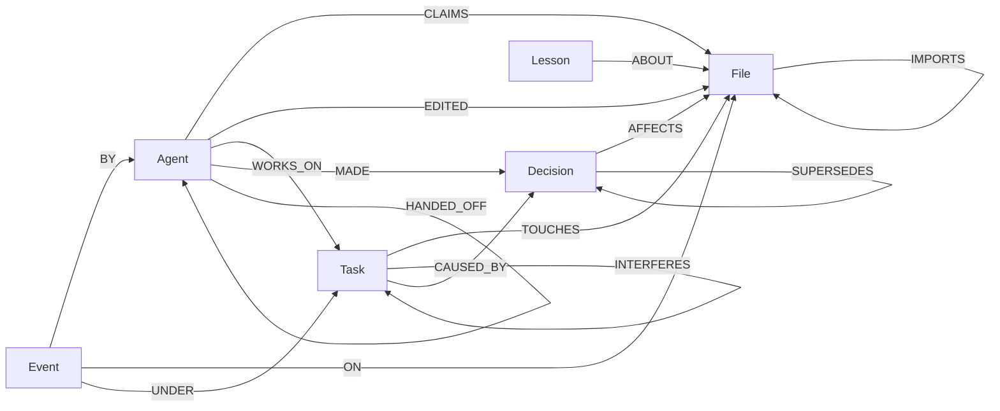
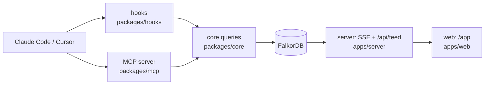

# Switchboard

Switchboard stops AI coding agents from breaking each other's code. It checks every edit against the repository's real import graph in FalkorDB. If the edit would collide with another agent's change, the edit is refused and the reply is the import path. A file lock only sees the filename.



**[Live demo](https://switchboard.bhargava-gumpula.com/app?play=1)** · [API health](https://switchboard-api.bhargava-gumpula.com/api/health) · 2-min video (TBD) · Blog (TBD) · Tracks: **Agent Memory & Coordination** (main), **Agents That Act on Connected Data**

[](https://github.com/bhargava-gumpula/graph-hacks/actions/workflows/uptime.yml)

## 30 seconds

Two agents share one repository.

1. Agent A claims `auth/session.ts` (task T1, "session ttl").
2. Agent B asks for `ui/LoginForm.tsx`. It is a different file, so a file lock says yes.
3. FalkorDB finds that `LoginForm.tsx` imports `api/login.ts`, which imports `session.ts`. B is refused:

> Agent B cannot edit ui/LoginForm.tsx. It reaches auth/session.ts, which agent A is already changing, through ui/LoginForm.tsx → api/login.ts → auth/session.ts. A file lock would have allowed the edit.

4. B asks for `ui/AboutPage.tsx`. The same query returns no rows. That empty result is the proof that nothing within 3 import hops is claimed, and the edit goes through.

That sentence is the reply of `POST /api/demo`. In Claude Code and Cursor the refusal arrives as a denied edit, with the path as the reason. Press Play at `/app?play=1`, or run `npm run scenario` to see the same story in a terminal.

## Why a graph

FalkorDB is the only store. There is no second database and no message broker. Remove it and the claim check, the event feed, the batches, the why-trace and the briefing all stop.

| Feature | FalkorDB query | Without FalkorDB |
|---|---|---|
| Conflict: does this edit reach another agent's claim? | `(f)-[:IMPORTS*1..3]->(g)<-[c:CLAIMS]-(o)` and the reverse direction, hubs skipped. The path comes back. | Two recursive CTEs, one per direction, each with a hand-built path column and a hub filter. A lock table only matches names. |
| Blast radius: who breaks if this file changes? | `(d)-[:IMPORTS*1..3]->(f {path: $path})`, nearest hop per dependent, with the agents holding claims on each. | A reverse recursive walk, then a join to claims. |
| Batches: which tasks can run together? | `CALL algo.WCC({nodeLabels: ['Task'], relationshipTypes: ['INTERFERES']})` | Build the pair list yourself, then run union-find in application code. |
| Hubs: which file is so widely imported that a path through it means nothing? | `CALL algo.pageRank('File', 'IMPORTS')` | Count importers by hand, or write PageRank. |
| Why: why does this file look like this? | edit → agent → task → decision, plus `SUPERSEDES*1..5` to the newest decision. | Five joins, one of them recursive. |
| Brief: what should a new agent know first? | `(f)-[:IMPORTS*0..2]-(g)` around the files it will touch, then claims, decisions and lessons on that set. | The same walk, then one join per kind of memory. |

## Quickstart

You need Node 22 or newer and Docker running. The first FalkorDB pull is about 200 MB.

```bash
npm ci && npm run db:up && npm run parse -- demo-repo
```

`db:up` starts FalkorDB on port 6379 (the database) and 3000 (FalkorDB Browser). `parse` loads the demo repo: 35 files and 51 import edges.

Dev path, with hot reload:

```bash
npm run server    # API on http://localhost:8787
npm run web       # Vite on http://localhost:5173, proxies /api to the server
```

Open http://localhost:5173/app.

Single-port path, one process serving the built app:

```bash
npm run build -w @switchboard/web && npm run server
```

Open http://localhost:8787/app.

Nothing loads `.env` for you. The defaults in the code match `.env.example`. To change a value, export it, for example `set -a; source .env; set +a`.

| Variable | Meaning |
|---|---|
| `FALKORDB_URL` | default `redis://localhost:6379` |
| `SB_GRAPH` | one FalkorDB graph per project, default `sb_demo` |
| `SERVER_PORT` | server port, default `8787` |
| `SB_PREFIX` | directory stripped from editor paths before a check. Default `demo-repo` |
| `SB_URL` | where the editor hooks reach the server. Default `http://localhost:8787` |
| `SB_AGENT` | agent id. Default is the git branch of the checkout |
| `SWITCHBOARD_OFF` | `1` lets every edit through |
| `ANTHROPIC_API_KEY` | optional. If set, `brief_me` adds a short Haiku summary on top of the graph text. If unset, the graph text is the whole answer |

`npm test` runs the queries against the same FalkorDB, in temporary graphs named `sb_test_*`.

## Plug in your agent (3 min)

You need Node 22+, Docker, `jq` (the hook script uses it; without `jq` the hooks do nothing) and Claude Code or Cursor.

```bash
npm install && npm run db:up && npm run parse -- demo-repo
npm run server        # keep it running
claude                # in the repo root
```

In Claude Code, approve the `switchboard` MCP server when it asks. The hooks load from `.claude/settings.json`.

In a second terminal, be agent A:

```bash
npm run switchboard -- claim auth/session.ts --agent A --task T1 --intent "session ttl"
```

Now ask the agent to edit `demo-repo/ui/LoginForm.tsx`. It is refused, and the reason is the path. Ask it to edit `ui/AboutPage.tsx`. That one is allowed. Then ask it to call `brief_me` and `why`.

- **Two real agents.** Run `SB_AGENT=alice claude` and `SB_AGENT=bob claude`, or give each agent its own git worktree. The agent id is the git branch, so two sessions on the same branch share one id and never conflict with each other.
- **Cursor.** Enable `switchboard` in Settings → Tools & MCP. `.cursor/hooks.json` loads automatically. Cursor drops the output of its session-start hook, so ask the agent to call `brief_me` first.
- **Off switch.** `SWITCHBOARD_OFF=1`. The hook log is `$TMPDIR/switchboard-hook.log`.

The MCP server exposes 13 tools:

| Tool | What it does |
|---|---|
| `register_agent` | Mark this agent active. |
| `claim` | Claim files before editing. `ok: false` carries the import path. |
| `release` | Drop your claims on some files, or all of them. |
| `heartbeat` | Tell the others you are still working; extends your claims. |
| `status` | Every agent and every live claim. |
| `record_decision` | Write a decision, its reason, and the files it affects. |
| `record_lesson` | Write a gotcha or a failed approach about some files. |
| `brief_me` | A briefing for a task or a directory: nearby claims, decisions, lessons, recent events, open tasks, the latest handoff. |
| `why` | Trace a file to the edit, the agent, the task and the decision behind it. |
| `blast_radius` | Files that import this one, hop by hop, and who holds them. |
| `plan_task` | Open a task and list the files it will touch. |
| `parallel_batches` | Group open tasks into batches that can run together. |
| `handoff` | Give a task to another agent with a note. |

## Graph model

One FalkorDB graph per project (`SB_GRAPH`). Nothing is shared across graphs. The demo graph holds 35 `File` nodes and 51 `IMPORTS` edges.



Node labels: `File`, `Agent`, `Task`, `Decision`, `Lesson`, `Event`, and `Meta` (the `seq` counter).

| Edge | From → To | Meaning |
|---|---|---|
| `IMPORTS` | File → File | Parsed from the code. |
| `CLAIMS` | Agent → File | The agent is editing that file until `until`. |
| `EDITED` | Agent → File | The agent wrote the file. |
| `WORKS_ON` | Agent → Task | The agent is on this task. |
| `TOUCHES` | Task → File | A task's planned files. |
| `INTERFERES` | Task → Task | Two open tasks can reach each other through imports. |
| `MADE` | Agent → Decision | Who made the decision. |
| `AFFECTS` | Decision → File | A decision applies to a file. |
| `CAUSED_BY` | Task → Decision | A task exists because of a decision. |
| `SUPERSEDES` | Decision → Decision | A newer decision replaced an older one. |
| `ABOUT` | Lesson → File | A lesson applies to a file. |
| `HANDED_OFF` | Agent → Agent | One agent gave a task to another. |
| `BY` / `ON` / `UNDER` | Event → Agent / File / Task | An event's agent, file and task. |

Memory types map to the graph like this. Episodic: `Event` with `BY`, `ON` and `UNDER`. Semantic: `Decision` with `AFFECTS` and `SUPERSEDES`. Procedural: `Lesson` with `ABOUT`. Shared state and handoffs: `CLAIMS`, `WORKS_ON`, `HANDED_OFF`. Per-project tenancy: one graph each.

`Event.seq` is allocated in the same write that creates the event, so the log has no gaps. The server watches `seq`, and the page follows it.

## The Cypher

These are the queries the product depends on. They live in [`packages/core/src/queries/`](packages/core/src/queries/), and each has a test against a real FalkorDB. This section is generated: `npm run readme` imports the exported query strings and writes them here, so it cannot drift from the code.

<!-- cypher:start -->

### Conflict

`conflictQuery(3)` in [`packages/core/src/queries/conflict.ts`](packages/core/src/queries/conflict.ts). For each file an agent asks for, find another agent's live claim on the same file (SAME), on a file it imports within 3 hops (UPSTREAM), or on a file that imports it within 3 hops (DOWNSTREAM). The path comes back with the row.

Why a lock table cannot do this: it compares names, so `LoginForm.tsx` and `session.ts` never meet. Here the import path is the answer.

```cypher
UNWIND $paths AS want
MATCH (f:File {path: want})<-[c:CLAIMS]-(o:Agent)
WHERE o.id <> $agent AND c.until > $now
RETURN want AS file, 'SAME' AS type, f.path AS claimed, [f.path] AS path, 0 AS hops,
       o.id AS agent, c.taskId AS taskId, c.intent AS intent
UNION ALL
UNWIND $paths AS want
MATCH p = (f:File {path: want})-[:IMPORTS*1..3]->(g:File), (g)<-[c:CLAIMS]-(o:Agent)
WHERE o.id <> $agent AND c.until > $now AND none(n IN nodes(p) WHERE coalesce(n.hub, false))
RETURN want AS file, 'UPSTREAM' AS type, g.path AS claimed, [n IN nodes(p) | n.path] AS path, length(p) AS hops,
       o.id AS agent, c.taskId AS taskId, c.intent AS intent
UNION ALL
UNWIND $paths AS want
MATCH p = (g:File)-[:IMPORTS*1..3]->(f:File {path: want}), (g)<-[c:CLAIMS]-(o:Agent)
WHERE o.id <> $agent AND c.until > $now AND none(n IN nodes(p) WHERE coalesce(n.hub, false))
RETURN want AS file, 'DOWNSTREAM' AS type, g.path AS claimed, [n IN nodes(p) | n.path] AS path, length(p) AS hops,
       o.id AS agent, c.taskId AS taskId, c.intent AS intent
```

### Conflict guard

`conflictGuard(3)` in [`packages/core/src/queries/conflict.ts`](packages/core/src/queries/conflict.ts). The same three checks as a prefix for a write. It yields one row when nothing conflicts and no rows otherwise, so whatever follows runs only when the claim is free.

Why a lock table cannot do this: its atomic step covers one name. This one covers every file within 3 import hops of the request.

```cypher
UNWIND $paths AS want
OPTIONAL MATCH (f:File {path: want})<-[c:CLAIMS]-(o:Agent)
WHERE o.id <> $agent AND c.until > $now
WITH want, count(c) AS same
OPTIONAL MATCH p = (f:File {path: want})-[:IMPORTS*1..3]->(g:File), (g)<-[c:CLAIMS]-(o:Agent)
WHERE o.id <> $agent AND c.until > $now AND none(n IN nodes(p) WHERE coalesce(n.hub, false))
WITH want, same, count(c) AS up
OPTIONAL MATCH p = (g:File)-[:IMPORTS*1..3]->(f:File {path: want}), (g)<-[c:CLAIMS]-(o:Agent)
WHERE o.id <> $agent AND c.until > $now AND none(n IN nodes(p) WHERE coalesce(n.hub, false))
WITH want, same, up, count(c) AS down
WITH sum(same + up + down) AS blocked
WITH blocked WHERE blocked = 0
```

### Claim: check and write in one query

`claimQuery(3)` in [`packages/core/src/queries/claims.ts`](packages/core/src/queries/claims.ts). The guard, then the write: the agent, its task, the `CLAIMS` edges and the `claim` event with the next `seq`. FalkorDB runs the write queries of one graph one at a time, so two racing claims cannot both pass the check.

Why a lock table cannot do this: it can make set-if-free atomic for a name, but it cannot put an import-path check in the same step.

```cypher
UNWIND $paths AS want
OPTIONAL MATCH (f:File {path: want})<-[c:CLAIMS]-(o:Agent)
WHERE o.id <> $agent AND c.until > $now
WITH want, count(c) AS same
OPTIONAL MATCH p = (f:File {path: want})-[:IMPORTS*1..3]->(g:File), (g)<-[c:CLAIMS]-(o:Agent)
WHERE o.id <> $agent AND c.until > $now AND none(n IN nodes(p) WHERE coalesce(n.hub, false))
WITH want, same, count(c) AS up
OPTIONAL MATCH p = (g:File)-[:IMPORTS*1..3]->(f:File {path: want}), (g)<-[c:CLAIMS]-(o:Agent)
WHERE o.id <> $agent AND c.until > $now AND none(n IN nodes(p) WHERE coalesce(n.hub, false))
WITH want, same, up, count(c) AS down
WITH sum(same + up + down) AS blocked
WITH blocked WHERE blocked = 0

MERGE (m:Meta {key:'seq'})
ON CREATE SET m.value = 0
SET m.value = m.value + 1
WITH m
CREATE (e:Event {seq: m.value, kind: $kind, at: $at, payload: $payload})
WITH e, m

MERGE (a:Agent {id: $agent})
ON CREATE SET a.status = 'active', a.startedAt = $at
SET a.lastSeen = $at, a.status = 'active'
CREATE (e)-[:BY]->(a)
FOREACH (_ IN CASE WHEN $taskId IS NULL THEN [] ELSE [1] END |
  MERGE (t:Task {id: $taskId})
  ON CREATE SET t.status = 'active', t.createdAt = $at
  MERGE (a)-[w:WORKS_ON]->(t)
  ON CREATE SET w.since = $at
  CREATE (e)-[:UNDER]->(t)
)
WITH e, m, a
UNWIND $paths AS path
MERGE (f:File {path: path})
ON CREATE SET f.hub = false, f.rank = 0.0
MERGE (a)-[c:CLAIMS]->(f)
SET c.since = $at, c.until = $until, c.ttl = $ttl, c.taskId = $taskId, c.intent = $intent
CREATE (e)-[:ON]->(f)
RETURN DISTINCT m.value AS seq
```

### Blast radius

`blastQuery(3)` in [`packages/core/src/queries/blast.ts`](packages/core/src/queries/blast.ts). Every file that imports the changed file within 3 hops, with its nearest hop count and the agents that hold a live claim on it. Zero rows means nothing depends on it.

Why a lock table cannot do this: it has no idea who depends on a file.

```cypher
MATCH p = (d:File)-[:IMPORTS*1..3]->(f:File {path: $path})
WHERE d <> f AND none(n IN nodes(p) WHERE coalesce(n.hub, false) AND n <> f)
WITH d, min(length(p)) AS hops, $now AS now
RETURN d.path AS path, hops, [(a:Agent)-[c:CLAIMS]->(d) WHERE c.until > now | a.id] AS agents
ORDER BY hops, path
```

### Interference between tasks

`interfereQuery(3)` in [`packages/core/src/queries/schedule.ts`](packages/core/src/queries/schedule.ts). For every pair of unfinished tasks, find the closest connection between their files: the same file, or an import path within 3 hops either way. The scheduler writes each row as an `INTERFERES` edge.

Why a lock table cannot do this: a lock exists only once an agent starts editing. This compares tasks before anyone has claimed anything.

```cypher
UNWIND $tasks AS a
UNWIND $tasks AS b
WITH a, b WHERE a.id < b.id
UNWIND a.paths AS p1
UNWIND b.paths AS p2
MATCH (f1:File {path: p1}), (f2:File {path: p2})
OPTIONAL MATCH up = (f1)-[:IMPORTS*1..3]->(f2)
WHERE none(n IN nodes(up) WHERE coalesce(n.hub, false))
OPTIONAL MATCH down = (f2)-[:IMPORTS*1..3]->(f1)
WHERE none(n IN nodes(down) WHERE coalesce(n.hub, false))
WITH a, b, f1, f2, min(length(up)) AS u, min(length(down)) AS d
WITH a, b, f1.path AS via,
     CASE WHEN f1 = f2 THEN 0 WHEN u IS NULL THEN d WHEN d IS NULL THEN u WHEN u < d THEN u ELSE d END AS hops
WHERE hops IS NOT NULL
WITH a, b, hops, via ORDER BY hops, via
WITH a.id AS a, b.id AS b, collect({hops: hops, via: via})[0] AS best
RETURN a, b, best.via AS via, best.hops AS hops
ORDER BY a, b
```

### Parallel batches (WCC)

`WCC_BATCHES` in [`packages/core/src/queries/schedule.ts`](packages/core/src/queries/schedule.ts). Weakly connected components over the `INTERFERES` edges. Tasks in one component run one after another. Different components can run at the same time.

Why a lock table cannot do this: it tells you who is waiting, not which tasks could never have collided.

```cypher
CALL algo.WCC({nodeLabels: ['Task'], relationshipTypes: ['INTERFERES']}) YIELD node, componentId
WITH node, componentId WHERE node.id IN $ids
RETURN componentId, collect(node.id) AS tasks
ORDER BY componentId
```

### Hubs (PageRank)

`MARK_HUBS` in [`packages/core/src/queries/hubs.ts`](packages/core/src/queries/hubs.ts). PageRank over `IMPORTS`, then a flag on the files everything imports (`lib/utils.ts` in the demo repo). Paths that run through a flagged file are ignored.

Why a lock table cannot do this: it cannot tell a file everyone imports from a file two agents really share, so a path through it would look like a dependency.

```cypher
CALL algo.pageRank('File', 'IMPORTS') YIELD node, score
SET node.rank = score
WITH collect(node) AS files, avg(score) AS mean
UNWIND files AS f
OPTIONAL MATCH (d:File)-[:IMPORTS]->(f)
WITH f, mean, count(d) AS indegree
SET f.hub = indegree >= $minDegree OR (indegree >= $floor AND f.rank >= $factor * mean)
RETURN f.path AS path, f.rank AS rank, indegree, f.hub AS hub
ORDER BY rank DESC, path
```

### Why

`WHY_TRACE` in [`packages/core/src/queries/why.ts`](packages/core/src/queries/why.ts). From a file back through its edits to the agent, the task, the decision that caused the task, and the newest decision that replaced it.

Why a lock table cannot do this: it forgets the claim when it is released. This is the history.

```cypher
MATCH (f:File {path: $path})<-[:ON]-(e:Event {kind: 'edit'})
OPTIONAL MATCH (e)-[:BY]->(a:Agent)
OPTIONAL MATCH (e)-[:UNDER]->(t:Task)
OPTIONAL MATCH (t)-[:CAUSED_BY]->(d:Decision)
OPTIONAL MATCH (da:Agent)-[:MADE]->(d)
OPTIONAL MATCH (d)<-[:SUPERSEDES*1..5]-(newer:Decision {status: 'active'})
RETURN e.seq AS seq, a.id AS agent, t.id AS task,
       d.id AS decisionId, d.text AS decision, d.why AS why, da.id AS decidedBy,
       newer.id AS latestId, newer.text AS latestText
ORDER BY seq DESC, decisionId
LIMIT $limit
```

### Briefing neighbourhood

`NEAR_FILES` in [`packages/core/src/queries/brief.ts`](packages/core/src/queries/brief.ts). The files within 2 imports of the area an agent is about to touch, in either direction. The briefing reads claims, decisions and lessons on exactly that set.

Why a lock table cannot do this: it can list who holds what, not what the neighbours of a file have learned.

```cypher
UNWIND $paths AS path
MATCH (f:File {path: path})
MATCH p = (f)-[:IMPORTS*0..2]-(g:File)
WHERE length(p) = 0 OR none(n IN nodes(p) WHERE coalesce(n.hub, false))
RETURN g.path AS path, min(length(p)) AS hops
```

<!-- cypher:end -->

### What the plan looks like

`GRAPH.PROFILE` on the conflict query, with agent A holding `auth/session.ts` and agent B asking for `ui/LoginForm.tsx`. This is the UPSTREAM branch of the `Union`, with the record counts left out; the SAME and DOWNSTREAM branches look alike. FalkorDB reported a median of 0.17 ms of internal execution time over 25 runs (0.12 to 0.46 ms, on a laptop shared with other jobs).

```text
Union
    Project
        Filter
            PathBuilder
                Filter
                    Conditional Variable Length Traverse | (f)-[_anon_0:IMPORTS*1..3]->(g)   0.024 ms
                        Filter
                            Filter
                                Edge By Index Scan | (o)-[c:CLAIMS]->(g:File)                0.004 ms
                                    Unwind
```

The plan starts at the live claims, through the index on `CLAIMS(until)`, and walks at most 3 `IMPORTS` hops from there. In this plan the cost scales with live claims, not repo size.

### Why not `shortestPath()`

FalkorDB allows `shortestPath()` only in `WITH` and `RETURN`, and it cannot carry the hub filter. So the query enumerates the paths (at most 3 hops by default, 4 at most) and TypeScript keeps the shortest one per file and agent. The hop bound is written into the query text because Cypher cannot take a parameter as a variable-length bound. It is checked to be an integer from 1 to 4 first.

## Architecture



Before an edit, the hook asks the server (or the CLI when the server is down) and denies the edit if the check finds a path. After an edit, it records the edit. The server reads new events from FalkorDB and pushes them over SSE. If a proxy buffers SSE, the page falls back to polling `GET /api/feed`.

## Benchmark

```bash
npm run bench
```

Agent A holds `auth/session.ts` and changes what `sessionLabel` returns. Agent B edits `ui/LoginForm.tsx` and uses that value. Each edit passes the TypeScript compiler on its own. Merged, they do not. Every trial copies `demo-repo`, applies the edits, and runs the real `tsc`.

- **Without Switchboard** a plain file lock lets B in, because B asks for a different file. Both edits land and the build breaks.
- **With Switchboard** B's claim is refused while A holds `session.ts`. A's edit lands and A releases. B then claims, applies its edit on top of A's, and its own `tsc` run catches the clash, so B's edit does not land.

<!-- bench:start -->

| | Broken builds | What happened |
|---|---|---|
| Without Switchboard | 10 / 10 | B's edit landed in 10 / 10 runs. |
| With Switchboard | 0 / 10 | B's claim was refused 10 / 10 times. B's edit landed in 0 / 10 runs. |

- Agent A holds `auth/session.ts`. Agent B edits `ui/LoginForm.tsx`.
- The conflict check (`findConflicts`, one FalkorDB query from Node) took a median of 0.65 ms (range 0.58 to 0.83 ms) over 10 runs.
- Last run: 2026-10-17, TypeScript 5.9.3, Node v26.9.0.

<!-- bench:end -->

What this does not show:

- The agents are scripted, not live model sessions. B waits and A releases through calls made in sequence, not real concurrency.
- It is one scenario on a 35-file synthetic repo. It shows the check catches that collision. It does not show how often real agents collide.
- The run is deterministic. N = 10 shows that it repeats, not a statistic.
- The build counts are the same every run by construction. The timing is the one noisy number: it comes from one local FalkorDB, and it moves with machine load.
- It does not model what a missed collision costs, or the rework B does after its `tsc` fails.

The full description is in [`bench/REPORT.md`](bench/REPORT.md).

## FalkorDB lessons

Four things we hit, each with a fix in the code.

1. `shortestPath()` is allowed only in `WITH` and `RETURN`. FalkorDB rejects it inside `MATCH`.
2. A variable-length bound cannot be a parameter. `*1..$k` fails, so `k` is validated and written into the text.
3. In one projection, `same + count(c)` returned null, and a null guard let every claim through. Each count now has its own `WITH`, and the filter comes after the last one.
4. `algo.pageRank` errors on a graph with no `File` nodes. `markHubs` counts files first.

## Limits

- TypeScript only. The parser reads static imports, re-exports and `import("literal")`. It does not see `require()` or computed imports.
- File-level. Two agents editing different functions in the same file still conflict. Two files that share only a database table or a config value do not.
- At most 3 import hops by default. A collision four or more imports apart is not caught.
- Paths do not pass through hubs. Editing a hub such as `lib/utils.ts` conflicts with its importers, but two files that merely share a hub do not conflict.
- The import graph is a snapshot from the last `npm run parse`. It does not update when files change.
- A claim is advice unless the editor runs the hook. Claude Code and Cursor both hard-block a denied edit. An agent with no hook only follows the contract of calling `claim`.

## Competitors

We read the READMEs and docs of the tools we found on Oct 14 (the list is in [`docs/research/SWITCHBOARD-COMPETITORS.md`](docs/research/SWITCHBOARD-COMPETITORS.md)). None of them checks an agent's claim against a parsed import graph and keeps decisions, lessons and edit history in that same graph database. Nerveplane schedules from hand-declared scopes and keeps its ledger in SQLite. wit is advisory and has no decision memory. Claude Code agent teams share a task list and tell you to give each teammate different files. A filename lock cannot express "these two files look independent and are two imports apart."

## AI disclosure

AI coding agents wrote most of this repository: Cursor (Claude Opus 5.5 and Grok 4.7) and Claude Code. Commits carry a `Co-Authored-By` line that names the tool. Task briefs, reviews and merges are recorded in [`docs/DEVLOG.md`](docs/DEVLOG.md).

The owner's decisions are in the table in [`docs/PLAN.md` §0.6](docs/PLAN.md#06-decisions-already-made-owner-oct-1314): the idea, the two tracks, the name, the coding workflow, the models, the video, the AI briefing summary and the benchmark. The owner also required that FalkorDB be the only store and that a claim be checked against a parsed dependency graph, and ran the day-0 tests of the Cursor and Claude Code hooks.

The first code commit (`aae6dc4`, Oct 14, 11:09 PM PT) came after the Oct 14 11:31 AM PT start. Every commit before it is Markdown notes, plus one Cursor rules file.

Inside the product, the only model call is an optional Claude Haiku summary of a briefing (`packages/core/src/summarize.ts`). It runs only when `ANTHROPIC_API_KEY` is set. The conflict check, the batches and the why-trace never call a model.

## License

[MIT](LICENSE)
